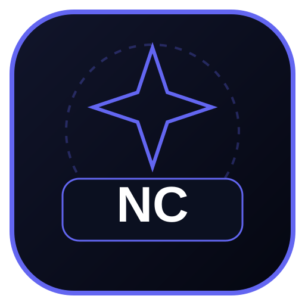

<p align="center">
  
</p>

# Nightcast

A browser-based shared media-room application for watching and listening together, with room management, synchronized playback, messaging, and real-time communication.

## Features

- Create and join rooms using invite codes or links
- Synchronized host-controlled media playback
- Persistent room messaging
- Voice messages and live voice chat
- WebRTC audio/video calls
- Media uploads backed by Supabase Storage

## Technology

- HTML, CSS, and JavaScript
- Supabase Database, Storage, and Realtime
- WebRTC for browser-based calls

## Run Locally

The client is served as a static web application. From the repository root, run:

```bash
python -m http.server 8000
```

Open `http://localhost:8000` in your browser. Configure the Supabase client in the application before using backend-dependent features.

## Deployment Notes

WebRTC connectivity can vary across networks. A TURN server is recommended for reliable calls in restrictive NAT and firewall environments. The public STUN configuration alone does not guarantee connectivity in every network.
